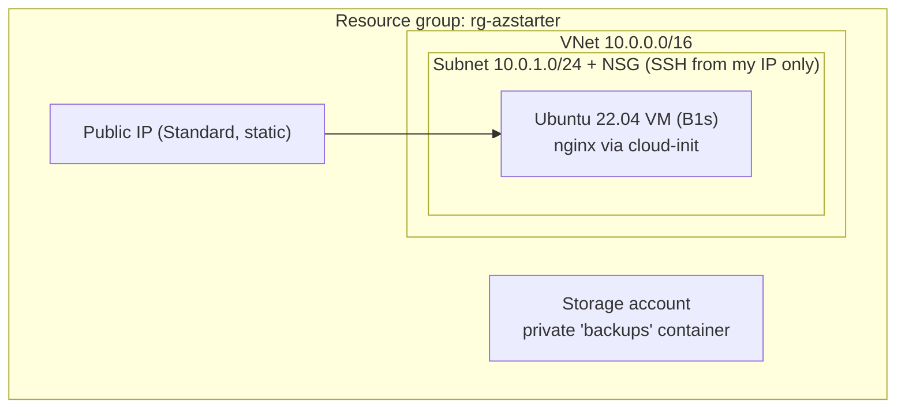

# azure-terraform-starter

A small Azure environment built entirely with Terraform: a network, a locked-down Linux VM running nginx, and a private storage account.

I built this while studying for AZ-104 to get hands-on with the core pieces (resource groups, VNets, NSGs, VMs, storage) instead of only clicking through the portal.

## What it creates



| Resource | Why it's set up this way |
|---|---|
| Resource group | Everything in one group, so cleanup is a single delete |
| NSG | SSH (port 22) allowed only from my own IP, nothing else inbound |
| Linux VM | SSH key login only, passwords disabled |
| cloud-init | Installs nginx on first boot, no manual setup |
| Storage account | TLS 1.2 minimum, no public blob access, random suffix for a globally unique name |
| Tags | Every resource tagged with project / owner / env |

## Files

```
versions.tf               Terraform + provider versions
variables.tf              Inputs (region, VM size, my IP, ...)
main.tf                   All the resources
cloud-init.yaml           First-boot script for the VM
outputs.tf                Public IP, SSH command, storage name
terraform.tfvars.example  Template for my own values
```

## How to run it

**Needs:** an Azure account (the free tier works), [Azure CLI](https://learn.microsoft.com/cli/azure/install-azure-cli), [Terraform](https://developer.hashicorp.com/terraform/install) 1.6+, and an SSH key (`ssh-keygen -t rsa -b 4096` if you don't have one).

```powershell
# 1. Log in and point Terraform at your subscription
az login
$env:ARM_SUBSCRIPTION_ID = az account show --query id -o tsv

# 2. Add your public IP (find it at https://ifconfig.me)
copy terraform.tfvars.example terraform.tfvars
# edit terraform.tfvars -> allowed_ssh_cidr = "<your-ip>/32"

# 3. Deploy
terraform init
terraform plan
terraform apply

# 4. Check it worked
ssh azureuser@<vm_public_ip>      # from the outputs
curl http://localhost              # run on the VM, should return the nginx page
```

On macOS/Linux, use `export ARM_SUBSCRIPTION_ID=$(az account show --query id -o tsv)` and `cp` instead.

## Clean up

```powershell
terraform destroy
```

⚠️ Don't leave it running. Even on the free tier, the public IP and anything beyond the free hours can cost money.

## What I learned

<!-- Fill this in after running it yourself: what broke, what surprised you, what you'd change -->

## Next steps

- [ ] Move Terraform state to an Azure Storage backend
- [ ] Split network / compute / storage into modules
- [ ] Add a Jenkins pipeline that runs `terraform plan` on every push
